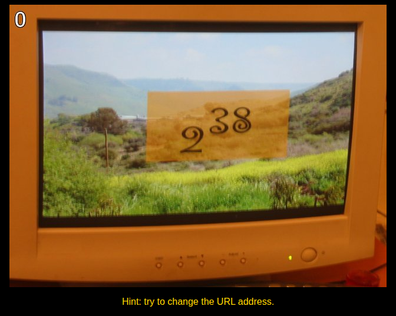
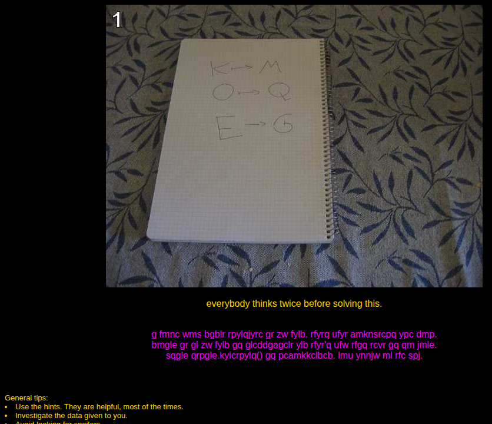
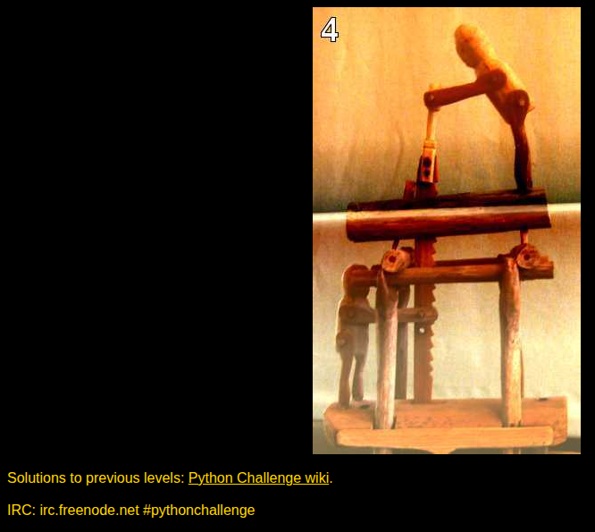

# Python Challenge

Solutions to the first seven riddles of [The Python Challenge](http://www.pythonchallenge.com/), levels 0 through 6.

Pranav Prem worked through them on 27 December 2013. The commits from that afternoon (`First four levels.`, `Level 5`, `6th one down.`) are the whole solving session. A one-paragraph README was added in September 2016, and the repository then sat still. The challenge is still online. It has 33 levels. This repository stops where that session stopped: the zip comments that spell **oxygen**.

The Python Challenge was built by Nadav Samet. Each level is a web page, and the answer is the next page's URL. The pages for the levels solved here:



*Level 0. The hint on the page is `2**38`.*



*Level 1. The pink text is a letter shift. The same shift applied to `map` is the next URL.*



*Level 4. Follow `linkedlist.php?nothing=12345` until the replies stop being numbers.*

## How it works

| Level | Page | What the solution does | Next URL |
| --- | --- | --- | --- |
| 0 | [`0.html`](http://www.pythonchallenge.com/pc/def/0.html) | Computes `2**38` | `274877906944` |
| 1 | [`map.html`](http://www.pythonchallenge.com/pc/def/map.html) | Shifts each letter forward by two | `ocr` |
| 2 | [`ocr.html`](http://www.pythonchallenge.com/pc/def/ocr.html) | Keeps characters that appear once in the page source | `equality` |
| 3 | [`equality.html`](http://www.pythonchallenge.com/pc/def/equality.html) | Finds a lowercase letter with three capitals on each side | `linkedlist` |
| 4 | [`linkedlist.php`](http://www.pythonchallenge.com/pc/def/linkedlist.php) | Follows `nothing is <n>` until the page is not a number | `peak.html` |
| 5 | [`peak.html`](http://www.pythonchallenge.com/pc/def/peak.html) | Unpickles `banner.p` and prints the run-length picture | `channel` |
| 6 | [`channel.html`](http://www.pythonchallenge.com/pc/def/channel.html) | Walks `channel.zip` and collects each file's zip comment | `oxygen` |

Level 1 was solved twice. `shift_by_hand` is the first attempt, a loop over character codes. The page then recommends `maketrans`, which is `str.maketrans` in Python 3. Both produce:

> i hope you didnt translate it by hand. thats what computers are for. doing it in by hand is inefficient and that's why this text is so long. using string.maketrans() is recommended. now apply on the url.

Levels 2 and 3 read the page bodies saved in 2013 (`data/level2.txt`, `data/level3.txt`). Level 5 reads `data/level5.txt`, which is the challenge's `banner.p`. Printed, it is the word **channel** drawn with `#`:

```
              #####                                                                      #####
               ####                                                                       ####
               ####                                                                       ####
               ####                                                                       ####
               ####                                                                       ####
               ####                                                                       ####
               ####                                                                       ####
               ####                                                                       ####
      ###      ####   ###         ###       #####   ###    #####   ###          ###       ####
   ###   ##    #### #######     ##  ###      #### #######   #### #######     ###  ###     ####
  ###     ###  #####    ####   ###   ####    #####    ####  #####    ####   ###     ###   ####
 ###           ####     ####   ###    ###    ####     ####  ####     ####  ###      ####  ####
 ###           ####     ####          ###    ####     ####  ####     ####  ###       ###  ####
####           ####     ####     ##   ###    ####     ####  ####     #### ####       ###  ####
####           ####     ####   ##########    ####     ####  ####     #### ##############  ####
####           ####     ####  ###    ####    ####     ####  ####     #### ####            ####
####           ####     #### ####     ###    ####     ####  ####     #### ####            ####
 ###           ####     #### ####     ###    ####     ####  ####     ####  ###            ####
  ###      ##  ####     ####  ###    ####    ####     ####  ####     ####   ###      ##   ####
   ###    ##   ####     ####   ###########   ####     ####  ####     ####    ###    ##    ####
      ###     ######    #####    ##    #### ######    ###########    #####      ###      ######
```

Level 6 follows the same kind of linked list, inside `data/channel.zip`. `readme.txt` says to start at `90052`. The comment on each zip entry is one character of this picture:

```
****************************************************************
****************************************************************
**                                                            **
**   OO    OO    XX      YYYY    GG    GG  EEEEEE NN      NN  **
**   OO    OO  XXXXXX   YYYYYY   GG   GG   EEEEEE  NN    NN   **
**   OO    OO XXX  XXX YYY   YY  GG GG     EE       NN  NN    **
**   OOOOOOOO XX    XX YY        GGG       EEEEE     NNNN     **
**   OOOOOOOO XX    XX YY        GGG       EEEEE      NN      **
**   OO    OO XXX  XXX YYY   YY  GG GG     EE         NN      **
**   OO    OO  XXXXXX   YYYYYY   GG   GG   EEEEEE     NN      **
**   OO    OO    XX      YYYY    GG    GG  EEEEEE     NN      **
**                                                            **
****************************************************************
 **************************************************************
```

Two traps in the original scripts are handled in the code now, instead of by editing a constant and running it again:

- Level 4 stops at `16044` and replies `Yes. Divide by two and keep going.` The 2013 script was restarted by hand at `8022`. It also has to ignore a decoy number (`82683`) and keep only the number in `nothing is <n>`.
- Level 6 was started at `94191`, which is the second file. That dropped the first `*` of the border. The start now comes from the zip's readme.

Level 4 still requests `pythonchallenge.com`. Everything else is local.

## Run it today

Python 3.11 or newer. There is nothing to install beyond the standard library if you only want to run the solutions:

```bash
python -m pythonchallenge
python -m pythonchallenge --level 5
python -m pythonchallenge --online
```

`--online` (or `--level 4`) follows the linked list on the challenge site, a few hundred small requests. The other levels do not use the network.

To run the tests and the linter as well:

```bash
python -m venv .venv
source .venv/bin/activate
python -m pip install -e ".[dev]"
pytest
ruff check .
ruff format --check .
```

`PYTHONCHALLENGE_ONLINE=1 pytest` includes the live level 4 check. Continuous integration skips it.

## Tech stack

- **Python 3.11+.** The 2013 scripts were Python 2 (`print` statements, `urllib2`, `string.maketrans`, a text-mode pickle).
- **Standard library only.** Arithmetic, `str.translate`, counting characters, `re`, `urllib.request`, `pickle`, and `zipfile`. No runtime dependencies.
- **Dev tools, pinned:** pytest 9.1.1 and ruff 0.17.0 (lint and format).
- **CI:** GitHub Actions on Python 3.11, 3.12, and 3.13.

## Project structure

```
pythonchallenge/
  level0.py … level6.py    one puzzle each; solve() returns the answer
  __main__.py              python -m pythonchallenge
  data_files.py            paths for the puzzle inputs
  data/
    level2.txt             ocr.html page body
    level3.txt             equality.html page body
    level5.txt             banner.p from peak.html
    channel.zip            level 6 archive
tests/test_levels.py
docs/screenshots/          the challenge pages these levels start from
.github/workflows/ci.yml
pyproject.toml
AGENTS.md                  notes for coding agents
CLAUDE.md                  pointer to AGENTS.md
```
